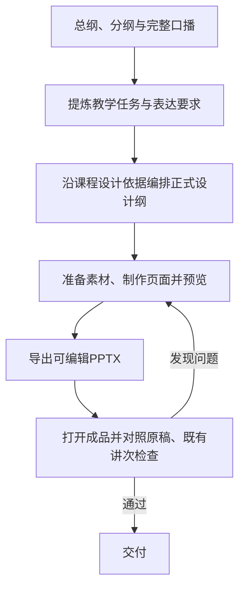

# 大纲、口播与课件的制作主线

日期：2026-10-14。课程PPT技能版本：0.5.0。

## 目标与职责

教师提供本次范围、授课大纲、完整口播及已有材料。口播端补充必要教学意图；PPT端在成熟原版策划中编排唯一正式设计纲，随后制作和审阅。避免转交摘要造成信息丢失，也保留原版逐页设计空间。

| 负责方 | 负责的决定 | 真实交付 |
| --- | --- | --- |
| 口播端 | 讲述内容、论证、教学重点、提问与揭示时机、专业条件 | 完整原稿；需要课件时沿既有记录补少量必要提示与材料身份 |
| PPT策划 | 屏幕任务、拆合页、同图显隐、资源与连续性 | 原版格式的 `design_spec.md`；执行摘录和机械核对输入各负其责 |
| PPT制作 | 具体构图、图像处理、几何、字号层级、点击实现 | 可编辑 PPTX，配备注与可回溯来源 |
| 审阅 | 原意和时序是否保留、画面是否兑现任务、专业设计是否达标 | 对照实际材料与成品的观察及修复结论 |

这沿用上游[职责划分](https://github.com/hugohe3/ppt-master/blob/ca04346de145ed6462ddf34682848e71df5e20a2/docs/rules/ownership.md)和[策划方法](https://github.com/hugohe3/ppt-master/blob/ca04346de145ed6462ddf34682848e71df5e20a2/skills/ppt-master/references/plan-core.md)：内容与关系保持来源，宏观构图作为参考，具体画面由制作者实现。以下是本项目加入的教学约定。

## 接入办法

1. **恢复真实材料。**核本次范围的大纲、完整原稿、版本及实际认可状态。提示、摘要和旧课件不能替代全文；没有提示则直接读原稿，不要求教师补表。
2. **提取教学意图。**在现有设计纲相应段落区分材料明确要求、PPT设计判断和真实冲突。用章节或原段定位；不另建平行大纲。
3. **编排画面。**按理解任务拆合页。定稿口播的措辞、讲述顺序、问题与揭示时机保留；无须一段一页。未经教师确认的页数、配色或图形建议可调整。
4. **进入既有制作与审阅。**沿用原版完整设计及 v0.4.0 的运行链。策划、前段和成品审阅对照原稿核时序、条件与关系；程序只验证字面、文件及对象事实。

提示中确有内容与原稿冲突时，指出位置、影响及建议。仅对需要教师决定的实质问题询问，其他独立准备继续。材料不足时标清输入边界；没有额外提示不等于材料不足。

## 实施落点

| 位置 | 本次落实 |
| --- | --- |
| PPT技能 `SKILL.md` | 明确完整主线与正式设计纲归属 |
| `references/material-to-expression.md` | 总纲、分纲与成稿分层读取；在原版策划中提炼表达义务，附合成正反例 |
| `references/course-design-continuity.md` | 每个独立讲次读同一课程设计依据并实际看代表页，继承共同角色而开放构图 |
| `references/course-design-input.md` | 输入角色、全文阅读、可选提示、原稿顺序、冲突处理及拆合页备注对应 |
| `references/teaching-customization-template.md` | 在现有模板中加入教学时机、来源定位和设计判断 |
| `references/design-review.md` | 核答案是否提前揭露、条件是否丢失、拆合页是否改变原意 |
| 口播技能的交付要求与既有工作记录 | 只在配套课件已获授权时补交接，保持原四步组稿和纯口述正文 |

不增加新的程序字段或并行生产器。两套技能仍可独立使用；改方法不自动修改课程稿、启动整课制作或安装其他技能。

## 验证与边界

v0.4.1已经用合成课堂材料进行三种前向试编：提供全文但无教学提示、提供包含未确认版式建议的提示、仅提供摘要，核了内容接入、教学时序及完成状态边界。v0.5.0进一步将四项补强交给实际小样制作，并在成品审阅中对照原材料及已认可代表页。

小样不等于整讲验证；已有程序测试不代替教学含义、视觉或实际课堂效果验证。具体小样结果与范围另在发行说明中记录；私人课程材料不随公开技能包分发。仍需在后续使用中持续验证专业完成度、教学效果与模型适应性。
